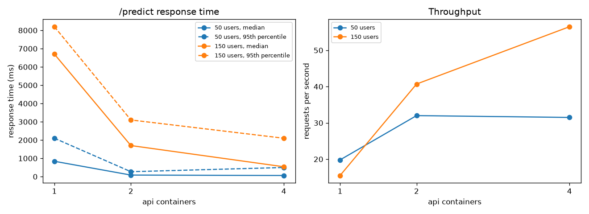

# Pneumonia X-ray Classifier

An end-to-end ML pipeline that classifies pediatric chest X-rays as NORMAL or PNEUMONIA, served through a web app where you can predict on one image, look at the data, upload new labelled images and retrain the model.

This builds on my machine learning summative, where I predicted sepsis in ICU patients from vital signs. Pneumonia is the most common infection that leads to sepsis, and the chest X-ray is usually how it gets confirmed, so catching it on the X-ray is one step earlier in the same story. This time the input is an image instead of a table.

## Links

* Video demo: VIDEO_LINK
* Live app: APP_URL
* API docs (Swagger): APP_URL/docs

## Dataset

Chest X-Ray Images (Pneumonia), Kermany et al., Mendeley Data v2, [doi:10.17632/rscbjbr9sj.2](https://data.mendeley.com/datasets/rscbjbr9sj/2), CC BY 4.0. It has 5,856 front-view chest X-rays of children aged one to five from Guangzhou Women and Children's Medical Center.

| Folder | NORMAL | PNEUMONIA | Use |
|---|---|---|---|
| `data/train` | 1,289 | 3,822 | training (85%) and validation (15%, split by patient) |
| `data/test` | 234 | 390 | final evaluation, also used to check every retrained model |
| `data/new_batch` | 60 | 61 | held out patients, used to try uploading and retraining |

The images in the repo are resized to 224x224 grayscale. `python -m src.data_acquisition` downloads the original 1.2 GB zip, checks it and rebuilds these folders.

## Model

MobileNetV2 pretrained on ImageNet, with a new head (dropout, dense layer with L2, sigmoid), then the last 40 layers fine-tuned at a low learning rate. Training uses augmentation (small rotation, zoom, shift, contrast), class weights, Adam, early stopping and ReduceLROnPlateau. The notebook compares four experiments:

| Run | Model | Test accuracy | Precision | Recall | F1 | ROC-AUC | Train time |
|---|---|---|---|---|---|---|---|
| E1 | CNN from scratch | 0.804 | 0.765 | 0.992 | 0.864 | 0.934 | 13.7 min |
| E2 | MobileNetV2, frozen, no extras | 0.804 | 0.763 | 0.997 | 0.864 | 0.958 | 3.1 min |
| E3 | E2 + augmentation, class weights, dropout, L2 | 0.819 | 0.778 | 0.995 | 0.873 | 0.958 | 2.2 min |
| E4 | E3 + fine-tuning the last 40 layers | 0.825 | 0.782 | 1.000 | 0.877 | 0.969 | 4.2 min |

Final model (E4) on the 624 test images, threshold 0.49 chosen on validation: accuracy 0.825, precision 0.782, recall 1.000, specificity 0.534, F1 0.877, ROC-AUC 0.969, loss 0.638.

The model never missed a pneumonia case on the test set, but it called 109 of the 234 normal X-rays pneumonia, even though validation accuracy was about 97%. The notebook goes into why (normal images differ from pneumonia images in size, framing and side markers, and the test normals look a bit different from the training normals). Retraining on 120 new images from `data/new_batch` raised test specificity from 0.534 to 0.658 and accuracy from 0.825 to 0.865.

The model file is `models/pneumonia_mobilenetv2.h5`, and `models/metadata.json` holds its version, threshold and metrics.

## How retraining works

1. Upload images on the "Upload and retrain" page (many files with one label, or a zip with `NORMAL/` and `PNEUMONIA/` folders). Each file is checked, saved to disk and recorded in a SQLite table.
2. Press "Retrain now". Retraining also starts on its own once 150 new images are waiting.
3. The job preprocesses the new images the same way as the training data (grayscale, 224x224) and mixes them with 300 old training images per class so the model does not forget.
4. It loads the current saved model and fine-tunes it (it does not start from zero).
5. Old and new model are both scored on the test set. The new one only goes live if its F1 is not more than 0.01 lower. The old version is kept in `models/versions/`.

## Load test (Locust)

I ran `locust/locustfile.py` against the Docker setup with 1, 2 and 4 api containers behind nginx. Each container is limited to 1 CPU. Every simulated user sends a random test X-ray to `/predict` (and sometimes checks `/health`), waiting 0.5 to 2 seconds between requests. Each run lasted 90 seconds. Raw csv files are in `locust/results/`.

| Users | Containers | Requests | Failures | Requests/s | Median (ms) | Average (ms) | 95th pct (ms) | 99th pct (ms) |
|---|---|---|---|---|---|---|---|---|
| 50 | 1 | 1,768 | 0 | 19.8 | 840 | 1,012 | 2,100 | 4,100 |
| 50 | 2 | 2,852 | 0 | 32.0 | 86 | 112 | 270 | 420 |
| 50 | 4 | 2,812 | 0 | 31.5 | 62 | 129 | 500 | 1,200 |
| 150 | 1 | 1,384 | 0 | 15.5 | 6,700 | 6,502 | 8,200 | 8,500 |
| 150 | 2 | 3,628 | 0 | 40.7 | 1,700 | 1,678 | 3,100 | 3,900 |
| 150 | 4 | 5,043 | 0 | 56.5 | 540 | 861 | 2,100 | 6,200 |



One container handles about 20 predictions per second, then requests start to queue and the response time climbs. With 50 users, two containers were already enough (median down from 840 ms to 86 ms) and four did not add much, because 50 users cannot send more than about 32 requests per second. With 150 users the extra containers really mattered: throughput went from 15.5 to 56.5 requests per second and the median response time dropped from 6.7 s to 0.54 s. It did not scale perfectly 4 times because all four containers, nginx and my other Docker containers shared the same 4 CPU virtual machine.

My first runs had a lot of 502 errors. The containers were being killed because memory kept growing under load, since FastAPI ran the TensorFlow calls on many threads at once. Running every prediction on one dedicated thread per container fixed it, and memory stayed around 500 MB.

## Project structure

```
pneumonia-xray-mlops/
├── README.md
├── Dockerfile
├── docker-compose.yml      api containers behind nginx
├── nginx.conf
├── requirements.txt        packages for the API
├── requirements-dev.txt    extra packages for the notebook and Locust
├── notebook/
│   └── pneumonia_xray.ipynb
├── src/
│   ├── config.py
│   ├── data_acquisition.py download and resize the dataset
│   ├── preprocessing.py
│   ├── model.py
│   ├── prediction.py
│   ├── retrain.py
│   ├── database.py         sqlite tables for uploads and retraining runs
│   ├── insights.py         numbers behind the Data insights page
│   └── api.py              FastAPI app
├── ui/                     web page (HTML, CSS, JS)
├── data/
│   ├── train/
│   ├── test/
│   └── new_batch/
├── models/
│   ├── pneumonia_mobilenetv2.h5
│   └── metadata.json
├── locust/                 locustfile, benchmark script and results
├── figures/                plots from the notebook
├── results/experiments.csv
└── logs/fit/               TensorBoard logs of the four experiments
```

## Setup

You need Python 3.12 and, for the container setup, Docker.

**Run locally without Docker**

```bash
git clone https://github.com/kbelyse/pneumonia-xray-mlops.git
cd pneumonia-xray-mlops
python -m venv .venv
source .venv/bin/activate        # Windows: .venv\Scripts\activate
pip install -r requirements-dev.txt
uvicorn src.api:app --port 8000
```

Then open http://localhost:8000.

**Run with Docker (several containers behind nginx)**

```bash
docker compose up --build -d --scale api=2
```

Then open http://localhost:8080. Change `--scale api=2` to any number of containers.

**Run the notebook**

```bash
jupyter notebook notebook/pneumonia_xray.ipynb
```

The first run downloads the original dataset (1.2 GB) into `data/raw`, because the data exploration reads the full-size images. TensorBoard logs: `tensorboard --logdir logs`.

**Retrain from the terminal**

```bash
python -m src.retrain
```

**Load test**

```bash
docker compose up --build -d
sh locust/run_benchmark.sh 50 90     # 50 users for 90 seconds, on 1, 2 and 4 containers
```

Or `locust -f locust/locustfile.py --host http://localhost:8080` for the Locust web page.
